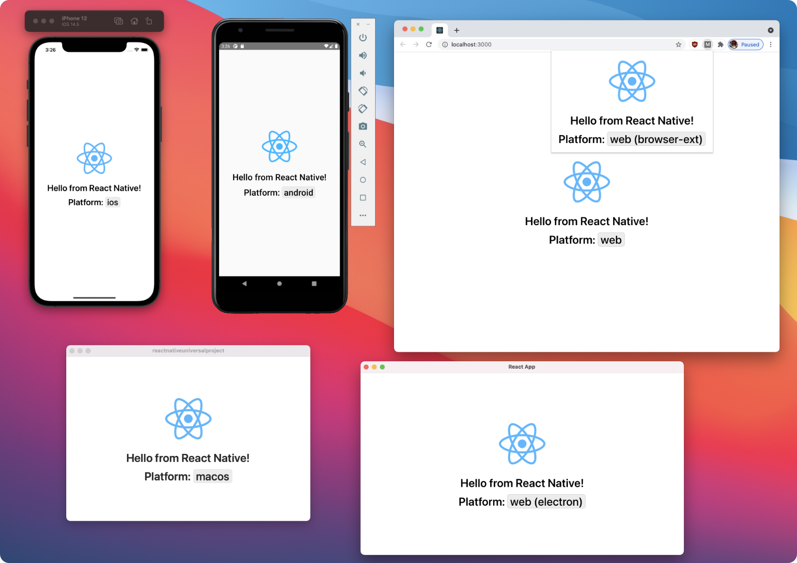

# React Native Universal Monorepo

An opinonated approach to supporting multiple platforms with React Native using a Yarn Workspaces monorepo.

**✨ Fully modernized with React 19, React Native 0.78, TypeScript 5.9, ESLint 9, and Tauri 2.0!**

## Modernization Stack

This monorepo has been fully modernized with the latest tools and frameworks:

### Core Technologies
- **React 19** - Latest React with improved performance and new features
- **React Native 0.78.3** - Latest stable React Native across all platforms
- **TypeScript 5.9** - Modern TypeScript with latest features
- **Yarn 4** - Fast, reliable package management with Plug'n'Play
- **Turborepo** - High-performance build system for monorepos

### UI & Styling
- **Gluestack UI v2** - Modern, accessible component library
- **NativeWind v4** - Tailwind CSS for React Native
- **React Native Web 0.19** - Run React Native on the web

### Desktop
- **Tauri 2.0** - Modern, secure desktop apps (replaces Electron)
- Smaller bundle sizes, better performance, enhanced security

### Developer Tools
- **ESLint 9** - Latest linting with flat config format
- **Prettier 3.4** - Modern code formatting
- **Jest 29** - Fast, reliable testing
- **Babel 7** - Modern JavaScript compilation

### Build & Deploy
- **Turborepo** - Parallel builds with intelligent caching
- **Metro Bundler** - React Native bundling
- **Next.js 11** - Server-side rendering for web  

Check out __[Running React Native everywhere](https://mmazzarolo.com/blog/2021-09-11-running-react-native-everywhere/)__ for an in-depth guide on how and why I recommend trying out this approach if you're planning to support multiple platforms in your app.
- [Overview](https://mmazzarolo.com/blog/2021-09-11-running-react-native-everywhere/)
- [Yarn Workspaces monorepo setup](https://mmazzarolo.com/blog/2021-09-12-running-react-native-everywhere-monorepo/)
- [Android & iOS](https://mmazzarolo.com/blog/2021-09-18-running-react-native-everywhere-mobile/)
- [Windows & macOS](https://mmazzarolo.com/blog/2021-09-19-running-react-native-everywhere-windows-macos/)
- [The Web](https://mmazzarolo.com/blog/2021-09-22-running-react-native-everywhere-web/)
- [Browser Extensions](https://mmazzarolo.com/blog/2021-09-25-running-react-native-everywhere-electron-browser-ext/)

&nbsp;

<p align="center" margin-bottom="0">
  
</p>

## Overview

This monorepo uses [Yarn workspaces](https://classic.yarnpkg.com/en/docs/workspaces/) and [TypeScript](https://www.typescriptlang.org/) to support a modular React Native project.  

The core idea is to isolate the JavaScript app code from the platform configurations (native code + the app bundlers like Metro and Webpack).  
This isolation happens by using different [workspaces](https://classic.yarnpkg.com/en/docs/workspaces/): We have an `app` workspace for the JavaScript app code, a `mobile` workspace for the React Native mobile configuration, a `macos` workspace for the React Native macOS configuration, and so on.  

We fully embrace [Yarn `nohoist`](https://classic.yarnpkg.com/blog/2018/02/15/nohoist/) to allow using different versions of React Native on each platform (which is recommended but not required), simplifying the adoption of new React Native updates.  
Thanks nohoist, each platform workspace (`mobile`, `macos`, etc.) can depend on any React Native version, regardless of what version the other platform workspaces are using. 
For example, we can use `react-native@0.65` on the mobile app and `react-native@0.63` on the macOS app — as long as the JavaScript app code supports both versions.  
This approach promotes gradual React Native updates over updates in lockstep.  

For more details, check out ["Running React Native everywhere: Yarn Workspaces monorepo setup"](https://mmazzarolo.com/blog/2021-09-12-running-react-native-everywhere-monorepo/).  

> ⚠️ Please notice that I'm not saying this is the _right_ way to do React Native monorepos. This is just an approach that I enjoy using on larger codebases :)

## Supported platforms

- Android (React Native 0.78)
- iOS (React Native 0.78)
- Windows (React Native 0.78)
- macOS (React Native 0.78)
- Android TV (React Native 0.78)
- tvOS (React Native 0.78)
- Web (React Native 0.78)
- Web - Browser Extension (React Native 0.78)
- Web - Next.js (React Native 0.78)
- Desktop - Tauri 2.0

## Getting started

You can use this repo as a boilerplate, removing the workspaces of platforms that you don't need, or you can create this setup from scratch if you want to fully understand how it works.

### Using this repository as a boilerplate

1. Clone the repository: `git@github.com:mmazzarolo/react-native-universal-monorepo.git`
2. Run yarn install: `cd react-native-universal-monorepo && yarn`
3. Start developing on your chosen platform (see [Available commands](#available-commands) below)

### Prerequisites

- **Node.js 18+** - Required for React Native 0.78 and modern tooling
- **Yarn 4** - Automatically managed via `.yarnrc.yml`
- **Platform-specific requirements:**
  - **iOS/macOS:** Xcode 14+, CocoaPods
  - **Android/Android TV:** Android Studio, JDK 17+
  - **Windows:** Visual Studio 2022 with C++ tools
  - **Desktop (Tauri):** Rust toolchain (see [Tauri prerequisites](https://tauri.app/v2/guides/prerequisites)) 

### Create this setup from scratch

Step by step tutorial on creating this repository from scratch:

- [Overview](https://mmazzarolo.com/blog/2021-09-11-running-react-native-everywhere/)
- [Yarn Workspaces monorepo setup](https://mmazzarolo.com/blog/2021-09-12-running-react-native-everywhere-monorepo/)
- [Android & iOS](https://mmazzarolo.com/blog/2021-09-18-running-react-native-everywhere-mobile/)
- [Windows & macOS](https://mmazzarolo.com/blog/2021-09-19-running-react-native-everywhere-windows-macos/)
- [The Web](https://mmazzarolo.com/blog/2021-09-22-running-react-native-everywhere-web/)
- [Browser Extensions](https://mmazzarolo.com/blog/2021-09-25-running-react-native-everywhere-electron-browser-ext/)

Tutorial for the TV and Next.js platforms from [@thefinnomenon](https://github.com/thefinnomenon):  
- [Adding tvOS & Android TV Support to Monorepo](https://finnternet.com/dev/blog/react-native-tv-monorepo)
- [Next.js in React-Native Monorepo](https://finnternet.com/dev/blog/nextjs-monorepo)

Additional resources:
- [Run your React Native app on the web with React Native for Web](https://mmazzarolo.com/blog/2020-10-24-adding-react-native-web/)
- [Developing a browser extension with Create React App](https://mmazzarolo.com/blog/2019-10-19-browser-extension-development/)
- [Tauri 2.0 - Build modern desktop apps](https://tauri.app/)

## Platform Setup Guides

### Tauri 2.0 Desktop Application

The monorepo includes a modern desktop application built with Tauri 2.0, replacing the legacy Electron implementation.

**Features:**
- Smaller bundle sizes (~600KB vs 100MB+ with Electron)
- Better performance and security
- Native system integration
- Cross-platform (macOS, Windows, Linux)

**Setup:**

1. Install Rust toolchain:
   ```bash
   # macOS/Linux
   curl --proto '=https' --tlsv1.2 -sSf https://sh.rustup.rs | sh

   # Windows
   # Download from https://rustup.rs
   ```

2. Install platform dependencies:
   ```bash
   # macOS: Xcode Command Line Tools
   xcode-select --install

   # Ubuntu/Debian
   sudo apt update
   sudo apt install libwebkit2gtk-4.1-dev build-essential curl wget file libssl-dev libayatana-appindicator3-dev librsvg2-dev

   # Windows: Microsoft C++ Build Tools
   # Download from https://visualstudio.microsoft.com/visual-cpp-build-tools/
   ```

3. Navigate to Tauri package and run:
   ```bash
   cd packages/tauri
   yarn tauri dev      # Development mode
   yarn tauri build    # Production build
   ```

**Documentation:**
- [Tauri 2.0 Guide](https://tauri.app/v2/guides/)
- [Tauri Configuration](https://tauri.app/v2/reference/config/)

---

## Available commands

Development and build commands:

- `yarn android:metro`: Start the metro server for Android/iOS
- `yarn android:start`: Start developing the Android app
- `yarn android:studio`: Open the android app on Android Studio
- `yarn ios:metro`: Start the metro server for Android/iOS
- `yarn ios:start`: Start developing the iOS app
- `yarn ios:pods`: Install iOS cocoapods dependencies
- `yarn ios:xcode`: Open the iOS app on XCode
- `yarn macos:metro`: Start the metro server for macOS
- `yarn macos:start`: Start developing the macOS app
- `yarn macos:pods`: Install macOS cocoapods dependencies
- `yarn macos:xcode`: Open the macOS app on XCode
- `yarn web:start`: Start developing the web app
- `yarn web:build`: Create a production build of the web app
- `yarn browser-ext:start`: Start developing the browser extension
- `yarn browser-ext:build`: Create a production build of the browser extension
- `yarn windows:metro`: Start the metro server for Windows
- `yarn windows:start`: Start developing the Windows app
- `yarn tv:android:metro`: Start the metro server for Android TV
- `yarn tv:android:start`: Start developing the Android TV app
- `yarn tv:android:studio`: Open the Android TV app in Android Studio
- `yarn tv:tvos:metro`: Start the metro server for tvOS
- `yarn tv:tvos:start`: Start developing the tvOS app
- `yarn tv:tvos:xcode`: Open the tvOS app in XCode
- `yarn tv:tvos:pods`: Install tvOS cocoapods dependencies
- `yarn next:start`: Start the Next.js app
- `yarn next:build`: Build the Next.js app
- `yarn next:serve`: Serve the Next.js app build

Other commands (we use [ultra-runner](https://github.com/folke/ultra-runner) to run these commands on all workspaces): 

- `yarn lint`: Lint each project
- `yarn lint:fix`: Lint + fix each project
- `yarn test`: Run tests of each project
- `yarn typecheck`: Run the TypeScript type-checking on each project

---

## Migration Guides

This monorepo has been modernized from legacy versions. Here are the key migrations:

### React 19 Migration

**Key Changes:**
- **No more `react-in-jsx-scope` rule** - React 19 doesn't require importing React in JSX files
- **Improved performance** - Automatic batching, transitions, and better rendering
- **New hooks** - `useOptimistic`, `useFormStatus`, `useFormState`
- **Better TypeScript support** - Improved type inference

**Breaking Changes:**
- PropTypes are deprecated (use TypeScript instead)
- Some legacy context APIs removed
- Default props handling changed in function components

**Migration Tips:**
```tsx
// ❌ Old (React 17)
import React from 'react';
export const Component = () => <div>Hello</div>;

// ✅ New (React 19) - import not needed for JSX
export const Component = () => <div>Hello</div>;
```

**Resources:**
- [React 19 Release Notes](https://react.dev/blog/2024/04/25/react-19)
- [React 19 Upgrade Guide](https://react.dev/blog/2024/04/25/react-19-upgrade-guide)

### ESLint v9 Migration

**Major Changes:**
- **Flat Config Format** - New `eslint.config.js` replaces `.eslintrc`
- **Modern Plugin System** - Updated plugin architecture
- **Better Performance** - Faster linting with improved caching

**Configuration:**

The monorepo uses a hybrid approach:
- **Root:** `eslint.config.js` (flat config) with backward-compatible `.eslintrc`
- **Packages:** Extend root config via `eslint.config.js`

**Example Configuration:**
```javascript
// eslint.config.js
const eslint = require("@eslint/js");
const tseslint = require("typescript-eslint");

module.exports = tseslint.config(
  eslint.configs.recommended,
  ...tseslint.configs.recommended,
  {
    rules: {
      "react/react-in-jsx-scope": "off", // Not needed in React 19
      "@typescript-eslint/no-explicit-any": "warn",
    }
  }
);
```

**Note:** The `eslint-plugin-react-native` is temporarily disabled due to ESLint 9 compatibility issues. It will be re-enabled when a compatible version is released.

**Resources:**
- [ESLint v9 Migration Guide](https://eslint.org/docs/latest/use/migrate-to-9.0.0)
- [Flat Config Documentation](https://eslint.org/docs/latest/use/configure/configuration-files)

### TypeScript 5.9 Upgrade

**New Features:**
- Improved type inference
- Better error messages
- Performance improvements
- New utility types

**Configuration:**
```json
{
  "compilerOptions": {
    "target": "ES2022",
    "module": "ESNext",
    "lib": ["ES2022"],
    "jsx": "react-native",
    "strict": true,
    "skipLibCheck": true
  }
}
```

### Tauri 2.0 (Electron Replacement)

**Why Tauri?**
- **93% smaller** bundle sizes
- **Better security** - Sandboxed by default
- **Better performance** - Native Rust backend
- **Lower memory usage** - ~50% less RAM

**Migration from Electron:**
1. Remove `packages/electron` directory (✅ Done)
2. Use `packages/tauri` instead
3. Update scripts in `package.json`
4. Test desktop functionality

---

## Native dependencies

While working on React Native in a monorepo, you'll notice that several packages won't work correctly when hoisted — either because they need to be natively linked or because they end up being bundled twice, breaking the build (e.g., `react`, `react-dom`).  
This is not an issue with the approach used in this project per se. It's more of a common problem with monorepos.  

To fix these issues, [we mark them as nohoist](https://classic.yarnpkg.com/blog/2018/02/15/nohoist/), so they will be installed in each package that depends on them.  

In this monorepo, you can see an example of such libraries in `react-native-async-storage`.  

In the metro bundler and Webpack configs used across the monorepo, [we're using a set of build-tools](https://github.com/mmazzarolo/react-native-monorepo-tools/) to ensure nohoisted packages are resolved correctly.  
So, as long as you add these libraries [to the `nohoist` list](https://github.com/mmazzarolo/react-native-universal-monorepo/blob/a7dcfcbe7c7df66f6d11f06dd13f51ff94b1e70c/package.json#L9-L19), you should be good to go 👍  

## Yarn 4 & Package Management

This monorepo uses **Yarn 4** with modern features for better performance and reliability.

### Configuration

The monorepo is configured via `.yarnrc.yml`:
```yml
nodeLinker: node-modules
nmHoistingLimits: workspaces
yarnPath: .yarn/releases/yarn-4.x.x.cjs
```

**Key Features:**
- **Plug'n'Play (PnP)** - Faster installs, zero-installs capability
- **Workspaces** - Monorepo support with proper hoisting
- **Constraints** - Ensure consistency across packages
- **Zero-Installs** - Optional mode for faster CI/CD

### Workspace Dependencies

Dependencies are managed via `nohoist` for platform-specific packages:
```json
{
  "nohoist": [
    "**/react",
    "**/react-dom",
    "**/react-native",
    "**/react-native/**"
  ]
}
```

This ensures each platform can use different versions of React Native without conflicts.

**Resources:**
- [Yarn 4 Documentation](https://yarnpkg.com/)
- [Workspaces Guide](https://yarnpkg.com/features/workspaces)

---

## Turborepo & Build System

This monorepo uses **Turborepo** for optimized builds and task execution.

### Features

- **Parallel Execution** - Run tasks across multiple packages simultaneously
- **Intelligent Caching** - Never rebuild the same code twice
- **Remote Caching** - Share build caches across team/CI
- **Pipeline Configuration** - Define task dependencies

### Configuration

Turborepo is configured via `turbo.json`:
```json
{
  "$schema": "https://turbo.build/schema.json",
  "pipeline": {
    "build": {
      "dependsOn": ["^build"],
      "outputs": ["dist/**", "build/**"]
    },
    "test": {
      "dependsOn": ["build"],
      "outputs": []
    },
    "lint": {
      "outputs": []
    },
    "typecheck": {
      "outputs": []
    }
  }
}
```

### Usage

```bash
# Run tasks across all packages
yarn turbo run build
yarn turbo run test
yarn turbo run lint

# Run with filtering
yarn turbo run build --filter=@my-app/mobile
yarn turbo run test --filter=@my-app/*

# Clear cache
yarn turbo run build --force
```

**Resources:**
- [Turborepo Documentation](https://turbo.build/repo/docs)
- [Caching Guide](https://turbo.build/repo/docs/core-concepts/caching)  


## Known issues

In some cases, Yarn Classic won't be able to resolve correctly dependencies that have a `peerDependency` on `react-native`.  
See [#22](https://github.com/mmazzarolo/react-native-universal-monorepo/issues/22) for a few workarounds. A fix on the `react-native-monorepo-tools` repo [is on the work](https://github.com/mmazzarolo/react-native-monorepo-tools/issues/9). 

## Contributing

Contributions, discussions, and feedback are welcome! Please ask if there are any active plans on feature changes before submitting new PRs 👍
